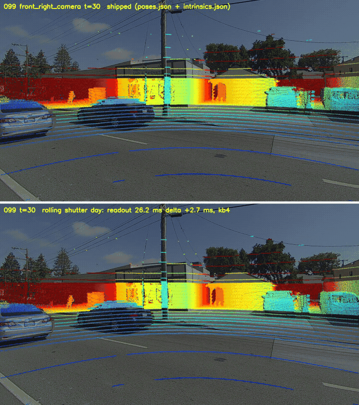
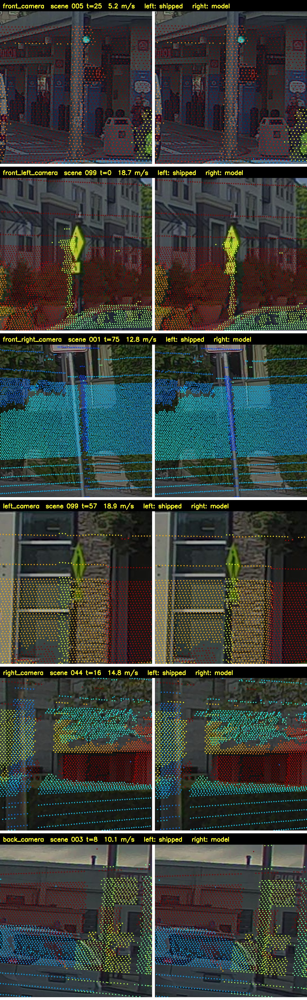

# PandaSet LiDAR–camera misalignment fixed: rolling shutter + time offset model for all 6 cameras

**If the PandaSet LiDAR does not line up with the camera images when you project it with the devkit** — points sliding off poles,
cars and building edges as the car speeds up, worse at the top of the image and in turns, worst on the side cameras — the cause is
not (only) the extrinsic calibration. The PandaSet cameras are **rolling-shutter** sensors, the dataset says nothing about when
each row was exposed, and the shipped projection treats every image as taken at one instant. This repository adds a small model that fixes it for all six cameras, with the parameters and a
visualisation script.

Keywords: PandaSet LiDAR camera misalignment, PandaSet projection offset, PandaSet calibration wrong, pandaset-devkit projection,
PandaSet vs Waymo, different from Waymo,
rolling shutter, camera time offset, LiDAR camera synchronisation, extrinsic calibration, lens distortion, Pandar64.



*Scene 099, `front_right_camera`, frames 30–49 at about 19 m/s, 3 frames/s. Top: shipped poses and intrinsics (devkit projection).
Bottom: this model. Colour = depth.*

## All six cameras, same frame (scene 099, frame 40, about 19 m/s)

Top half of each image: shipped projection. Bottom half: rolling-shutter model with `rs_calib/rs_params.json`.

**`front_camera`**


**`front_left_camera`**


**`front_right_camera`**


**`left_camera`**


**`right_camera`**


**`back_camera`**


## Zoom on poles, one per camera

Crops around a pole (or a thin post) for each camera, at the fastest frame where we marked one. Left: shipped projection. Right:
this model. Scene, frame and speed are written above each pair.



Make the same pictures (and a video) for any scene and camera:

```bash
pip install -e python                         # the devkit (pandaset.geometry)
export PANDASET_ROOT=/path/to/pandaset         # one folder per sequence: 001, 002, ...
cd rs_calib
python viz_projection.py --scene 099 --cam front_right_camera --frames 0-79 --out out/099_front_right --video --layout vertical
```

## What is wrong with the shipped projection

What is actually known about the cameras is little:

- **They are rolling-shutter sensors that read out top to bottom.** That much follows from the camera model in the paper
  (Leopard LI-USB30-AR023ZWDRB, ON Semiconductor AR0231, electronic rolling shutter).
- **Nothing tells you when the rows were exposed.** PandaSet ships one timestamp per image and no shutter information: no readout
  start / end, no exposure time, no trigger time. (Other datasets ship these, e.g. Waymo Open gives `camera_trigger_time`,
  `camera_readout_done_time` and `shutter` for every image.) The devkit treats every row as taken at the timestamp.
- **The timestamp itself cannot be trusted.** The paper describes it as the trigger time (the 360-degree LiDAR crossing the centre of
  the camera's field of view) plus an estimated exposure time, one constant for day and one for night. In the data it equals the
  LiDAR crossing of the centre column (+0.4 to +0.7 ms) in day, dusk and night scenes alike, so no exposure constant shows up, and
  the projection does not fit at speed. Which instant the timestamp stands for, and how long the readout takes, has to be
  recovered by aligning the images with the LiDAR.
- **The field of view does not match the paper either.** The paper gives 107 deg horizontal for the five wide-angle cameras; the
  shipped `intrinsics.json` (fx about 930 px on 1920 px, pinhole, no distortion) gives about 92 deg. The images are distorted at the
  edges, and the distortion coefficients in `docs/static_extrinsic_calibration.yaml` do not fit the shipped images, so the lens
  model has to be recovered as well.
- While the car stands still, the shipped projection fits well and the error grows with speed. This is why it is easy to blame the
  extrinsics, and why re-calibrating the extrinsics on moving data gives a different, speed-dependent answer.

What we recovered by aligning with the LiDAR (the model below, values in `rs_calib/rs_params.json`): with the rows read out top to
bottom, the projection fits when the bottom row is taken 3–14 ms after the timestamp (day / dusk / night) and the top row about
30 ms before the bottom row; at 19 m/s that is about 0.6 m of car motion between the top and the bottom of one image. The readout and the offset differ between the
day, dusk and night recordings (auto exposure), the shutter timing jitters by roughly 1–2 ms from frame to frame, and the
wide-angle cameras need small extrinsic corrections and a KB4 lens. This is a fit, not a specification; nothing in the dataset
states it.

**The individual values are not necessarily the physical ones.** The timing is a parameter of the model, but depending on the
camera and on how the car moves it is partly degenerate with the camera position and the principal point: for a side camera
while driving straight, a time offset, a shift of the camera along the driving direction and a shift of cx all move the projection
in nearly the same way, and a longer readout can be traded against a later offset. The fit picks one combination of these. What
is checked is the result: the LiDAR lines up with the images (pole, car and building edges, across speeds, rows and cameras). Do
not read `readout`, `delta`, `tx_cm` ... as measured sensor properties.

## Different from Waymo: what PandaSet does not ship

Waymo Open Dataset uses rolling-shutter cameras too, but ships the timing and the motion needed to project correctly. PandaSet does not:

| per image / per camera | Waymo Open Dataset (v2) | PandaSet |
|---|---|---|
| trigger time | `camera_trigger_time` | no |
| end of readout | `camera_readout_done_time` | no |
| exposure time | `shutter` | no (the paper mentions one estimated constant for day and one for night) |
| readout direction | `rolling_shutter_direction` per camera | no (top to bottom, from the sensor model) |
| ego pose and velocity at the image | `pose`, `velocity` per image | camera pose per image, no velocity |
| lens distortion | k1, k2, p1, p2, k3 per camera | none in `intrinsics.json`; the YAML coefficients do not fit the images |
| LiDAR point -> pixel | `camera_projection` per LiDAR point | no |
| image timestamp | consistent with the above | one value; what it stands for has to be recovered from the LiDAR |

So with PandaSet the shutter timing, the readout and the lens have to be estimated from the data before the LiDAR can be
projected onto moving images. This repository does that.

## The model (`rs_calib/rs_model.py`)

For an image of camera `c` with timestamp `t_img`, every LiDAR point is projected with the camera pose at the time of the image row
`v` it lands on (3 fixed-point passes):

```
t(v)   = t_img + delta - readout * (1079 - v) / 1079     # ms; bottom row = t_img + delta, top row readout earlier
ego(t) = front-camera pose (poses.json) at t_img, moved with constant velocity (central difference of the front poses)
pose_c = ego(t) * X_c * C_c     # X_c: shipped extrinsic (camera -> front camera, mean over frames)
                                # C_c: correction, shift tx, ty, tz (cm) + yaw / pitch / roll (deg) in the camera frame
pixel  = lens_c(K_c, point)     # K_c: shipped fx, fy, cx + dcx, cy + dcy; lens pinhole or Kannala-Brandt 4 terms (KB4)
```

`readout` and `delta` are shared by all cameras of one light group, chosen from the local (US Pacific) time of the scene's first
timestamp: 2019-05-11 morning = `day`, 2019-05-10 before 21:00 = `dusk`, 21:00 or later = `night`.

```python
import sys; sys.path.insert(0, 'rs_calib')
from pandaset_io import Scene
from rs_model import Projector, load_params

sc = Scene('099')                                            # PANDASET_ROOT must be set
p = load_params('rs_calib/rs_params.json', sc, 'left_camera')
uv, depth, idx = Projector(sc, 'left_camera', p).project(sc.lidar(40, 0)[:, :3], 40)   # pixels, depth, index of the drawn points
```

## How the parameters were obtained

The parameters were not fitted to a full ground truth. They come from a small number of object-level correspondences between
image segments and LiDAR points, collected interactively, and one solver shared by all sequences and cameras.

1. **Start from the shipped calibration** and look at the projection frame by frame (the side-by-side view above). Coarse values
   (readout, delta, a few tenths of a degree, a few cm, the KB4 coefficients) were first set by eye on frames where the drift is
   obvious: high speed, near poles and cars, turns, the image edges.
2. **Object correspondences ("snapshots").** On a frame, click an object (pole, sign, car, building corner). A SAM 3 point prompt
   segments it. The LiDAR points that project into the mask with the current parameters are split into depth groups (a new group
   starts at a depth gap larger than max(0.5 m, 5 %)). The object's group is the one with the largest
   (points inside the mask) x (share of the LiDAR points at that depth, inside a box 1.5x the mask, that fall in the mask): the
   object lies mostly inside its mask, the background behind it spreads outside, stray points are few. The group's points
   (world coordinates) and the mask are stored. This takes a second per object and needs no annotation.
3. **One solver for everything.** All snapshots of all sequences and cameras go into one robust least-squares problem (a small
   factor graph):
   - variables: `readout`, `delta` per light group (shared by all cameras); per camera the extrinsic correction (yaw, pitch, roll,
     tx, ty, tz), the principal-point shift (dcx, dcy) and, for KB4 cameras, k1..k4;
   - one factor per snapshot point: the px distance of its projection (with the full model above) to the snapshot's mask
     (0 inside, bilinear distance transform outside; or, alternatively, to the pixel the point had when the snapshot was taken);
     10 points per object, spread from top to bottom so that every object weighs the same and the rows constrain the readout;
   - one prior per variable that keeps it near its current value (0.2 deg, 5 cm, 10 px, 5 ms, 0.05 for k), so variables that no
     snapshot constrains do not drift;
   - Huber loss (1 px), trust-region least squares with a forward-difference Jacobian in which each variable re-projects only the
     snapshots it affects (a camera's variables only that camera's points, a light group's timing only that group's scenes).
4. **Iterate.** Solve a few iterations, look at the projection again, add snapshots where it still drifts (other scenes, speeds,
   image rows, cameras), solve again. 199 objects in 23 scenes were used (84 day, 115 dusk; front 13, front_left 45,
   front_right 36, left 35, right 58, back 12). The night timing has no snapshots and was set by eye only.

The tool used for steps 1–4 (an interactive web page with the snapshot and the solve) is not part of this repository; the model,
the parameters and the visualisation here are enough to use the result.

## Parameters (`rs_calib/rs_params.json`)

```json
{"timing":  {"day": {"readout": ms, "delta": ms}, "dusk": {...}, "night": {...}},
 "cameras": {"left_camera": {"yaw": deg, "pitch": deg, "roll": deg, "tx_cm": cm, "ty_cm": cm, "tz_cm": cm,
                             "dcx_px": px, "dcy_px": px, "lens": "pinhole" | "kb4", "k1": .., "k2": .., "k3": .., "k4": ..}, ...}}
```

The values were set by eye on many scenes and refined with a least-squares fit to hand-picked objects. They reproduce the
LiDAR alignment; individually they may not be the physical values (timing, camera position and principal point are partly
degenerate, see above). They are approximate:
the shutter timing also jitters by roughly 1–2 ms from frame to frame, which no constant removes; at speed this still shows on near
objects. Missing entries mean no correction and a pinhole lens.

## Files

| file | content |
|---|---|
| `rs_calib/rs_model.py` | projection model (`Projector`, `load_params`, `light_group`) |
| `rs_calib/rs_params.json` | parameters |
| `rs_calib/viz_projection.py` | images / video: shipped projection vs. model, side by side or one above the other |
| `rs_calib/pandaset_io.py` | minimal reader for one sequence (images, poses, timestamps, LiDAR) |
| `README_devkit.md`, `python/`, `tutorials/` | the original pandaset-devkit, unchanged |

## Licence and attribution

- The devkit is Apache License 2.0 (`LICENSE.md`, Copyright Scale AI); the `rs_calib/` files and `docs/rs_calib/` images are additions.
- PandaSet is provided by Scale AI and Hesai under CC BY 4.0 with additional Dataset Terms (pandaset.org). The parameters and the
  images here are derived from PandaSet and are subject to the same terms. This work is not affiliated with or endorsed by Scale AI or
  Hesai.
