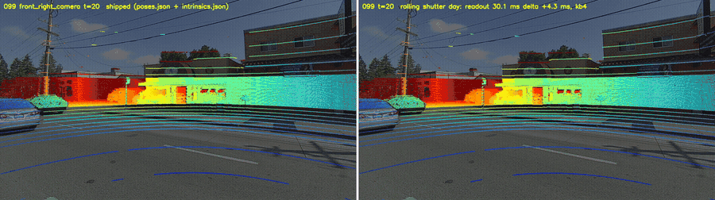
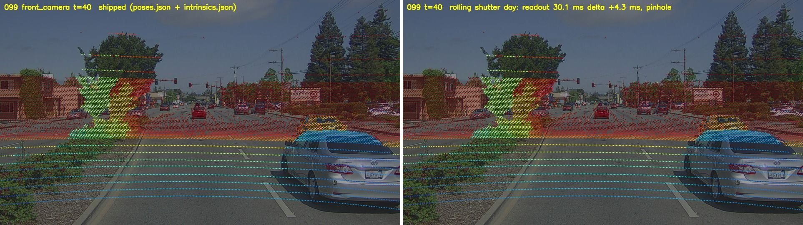
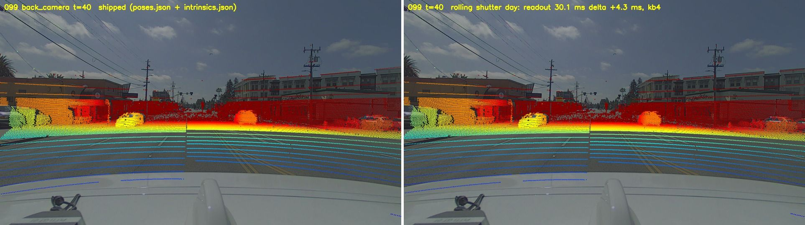
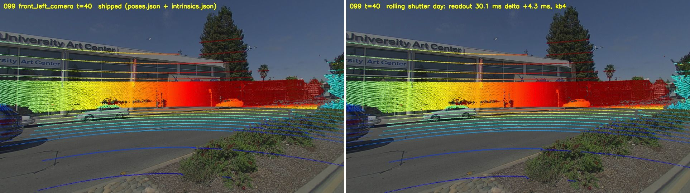
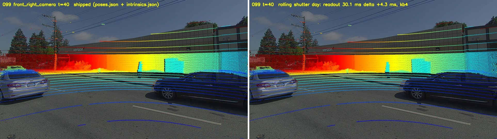
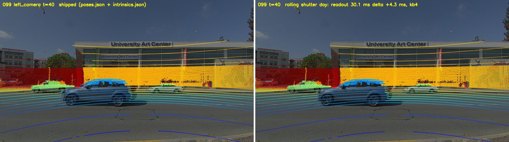
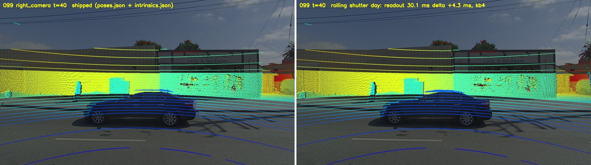

# PandaSet LiDAR–camera misalignment fixed: rolling shutter + time offset model for all 6 cameras

**If the PandaSet LiDAR does not line up with the camera images when you project it with the devkit** — points sliding off poles,
cars and building edges as the car speeds up, worse at the top of the image and in turns, worst on the side cameras — the cause is
not (only) the extrinsic calibration. The PandaSet cameras are **rolling-shutter** sensors and the shipped projection treats every
image as taken at one instant. This repository adds a small model that fixes it for all six cameras, with the parameters and a
visualisation script.

Keywords: PandaSet LiDAR camera misalignment, PandaSet projection offset, PandaSet calibration wrong, pandaset-devkit projection,
rolling shutter, camera time offset, LiDAR camera synchronisation, extrinsic calibration, lens distortion, Pandar64.



*Scene 099, `front_right_camera`, frames 20–59 at about 19 m/s. Left: shipped poses and intrinsics (devkit projection). Right: this
model. Colour = depth.*

## All six cameras, same frame (scene 099, frame 40, about 19 m/s)

Left half of each image: shipped projection. Right half: rolling-shutter model with `rs_calib/rs_params.json`.

| | |
|---|---|
| `front_camera`  | `back_camera`  |
| `front_left_camera`  | `front_right_camera`  |
| `left_camera`  | `right_camera`  |

Make the same pictures (and a video) for any scene and camera:

```bash
pip install -e python                         # the devkit (pandaset.geometry)
export PANDASET_ROOT=/path/to/pandaset         # one folder per sequence: 001, 002, ...
cd rs_calib
python viz_projection.py --scene 099 --cam front_right_camera --frames 0-79 --out out/099_front_right --video
```

## What is wrong with the shipped projection

- **The timestamp of an image is the bottom row, not the whole image.** Each image timestamp equals the moment the 360-degree LiDAR
  sweeps across the centre column of that camera (+0.4 to +0.7 ms, identical in day, dusk and night scenes, so no exposure time is
  added). The **bottom** row is exposed at that time and the rows above earlier — the top row about 30 ms earlier. At 19 m/s that is
  about 0.6 m of car motion between the top and the bottom of one image.
- **The readout differs between the recordings** (day / dusk / night; the cameras run auto exposure).
- **The wide-angle cameras need small extrinsic corrections and some lens distortion at the image edges.** `intrinsics.json` has
  fx, fy, cx, cy only (pinhole). The distortion coefficients in `docs/static_extrinsic_calibration.yaml` do not fit the shipped images.
- While the car stands still, the shipped projection fits well; the error grows with speed. This is why it is easy to blame the
  extrinsics, and why re-calibrating the extrinsics on moving data gives a different, speed-dependent answer.

## The model (`rs_calib/rs_model.py`)

For an image of camera `c` with timestamp `t_img`, every LiDAR point is projected with the camera pose at the time of the image row
`v` it lands on (3 fixed-point passes):

```
t(v)   = t_img + delta - readout * (1079 - v) / 1079     # ms; bottom row = t_img + delta, top row readout earlier
ego(t) = front-camera pose (poses.json) at t_img, moved with constant velocity (central difference of the front poses)
pose_c = ego(t) * X_c * C_c     # X_c: shipped extrinsic (camera -> front camera, mean over frames)
                                # C_c: correction, shift tx, ty, tz (cm) + yaw / pitch / roll (deg) in the camera frame
pixel  = lens_c(K_c, point)     # K_c: shipped fx, fy, cx + dcx, cy + dcy; lens pinhole or Kannala-Brandt 4 terms (KB4)
```

`readout` and `delta` are shared by all cameras of one light group, chosen from the local (US Pacific) time of the scene's first
timestamp: 2019-05-11 morning = `day`, 2019-05-10 before 21:00 = `dusk`, 21:00 or later = `night`.

```python
import sys; sys.path.insert(0, 'rs_calib')
from pandaset_io import Scene
from rs_model import Projector, load_params

sc = Scene('099')                                            # PANDASET_ROOT must be set
p = load_params('rs_calib/rs_params.json', sc, 'left_camera')
uv, depth, idx = Projector(sc, 'left_camera', p).project(sc.lidar(40, 0)[:, :3], 40)   # pixels, depth, index of the drawn points
```

## Parameters (`rs_calib/rs_params.json`)

```json
{"timing":  {"day": {"readout": ms, "delta": ms}, "dusk": {...}, "night": {...}},
 "cameras": {"left_camera": {"yaw": deg, "pitch": deg, "roll": deg, "tx_cm": cm, "ty_cm": cm, "tz_cm": cm,
                             "dcx_px": px, "dcy_px": px, "lens": "pinhole" | "kb4", "k1": .., "k2": .., "k3": .., "k4": ..}, ...}}
```

The values were set by eye on many scenes and refined with a least-squares fit to hand-picked objects. They are approximate:
the shutter timing also jitters by roughly 1–2 ms from frame to frame, which no constant removes; at speed this still shows on near
objects. Missing entries mean no correction and a pinhole lens.

## Files

| file | content |
|---|---|
| `rs_calib/rs_model.py` | projection model (`Projector`, `load_params`, `light_group`) |
| `rs_calib/rs_params.json` | parameters |
| `rs_calib/viz_projection.py` | side-by-side images / video: shipped projection vs. model |
| `rs_calib/pandaset_io.py` | minimal reader for one sequence (images, poses, timestamps, LiDAR) |
| `README_devkit.md`, `python/`, `tutorials/` | the original pandaset-devkit, unchanged |

## Licence and attribution

- The devkit is Apache License 2.0 (`LICENSE.md`, Copyright Scale AI); the `rs_calib/` files and `docs/rs_calib/` images are additions.
- PandaSet is provided by Scale AI and Hesai under CC BY 4.0 with additional Dataset Terms (pandaset.org). The parameters and the
  images here are derived from PandaSet and are subject to the same terms. This work is not affiliated with or endorsed by Scale AI or
  Hesai.
