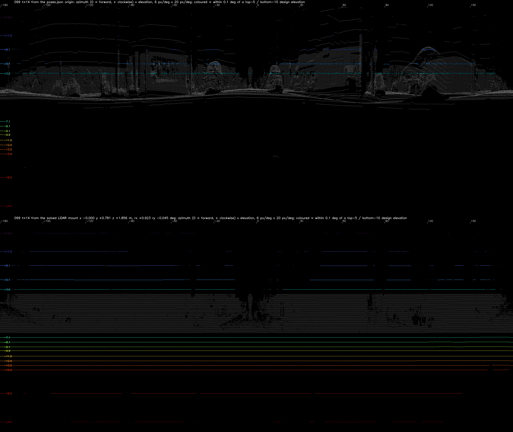
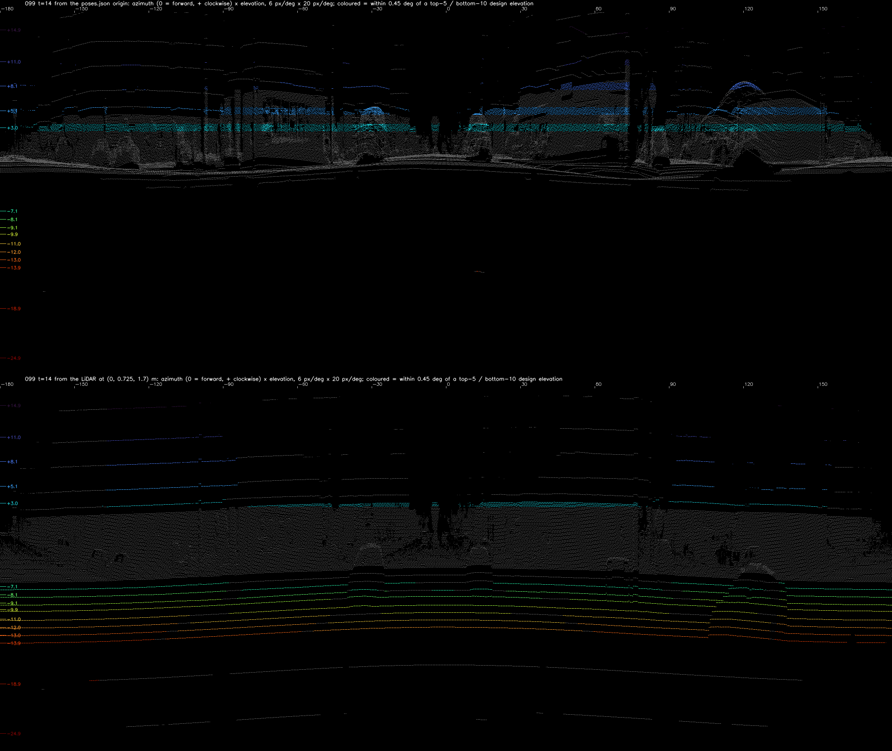
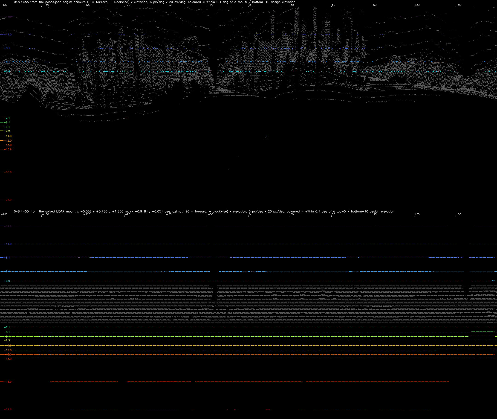

# Getting PandaSet's Pandar64 back to sensor observations

PandaSet ships its 360° LiDAR (Hesai Pandar64) as points already placed in world coordinates. It does not ship the LiDAR's mounting position, the beam (channel) of each point, or the raw sweep. This page shows how to recover all three from what is shipped: the world points, each point's timestamp, `lidar/poses.json`, and the Pandar64 user manual.

**Result, in short**

- `lidar/poses.json` is not the Pandar64. Its origin sits about 0.3 m above the road, which matches the IMU in the paper's sensor layout.
- Relative to that origin, the Pandar64 is at x −0.001, y +0.782 (forward), z +1.860 m. It is tilted +0.90° about the x (right) axis. These are medians over 20 scenes; the 20 agree to within 4–7 mm.
- With that mount, 99.5–99.8% of points get a channel ID in 14 of the 20 scenes. The other 6 scenes reach only 93.3–99.1%.
- Two channels of the same firing share a timestamp. 99.5–99.98% of same-time pairs are a firing pair in the manual's table, which checks the IDs independently.

**The key step** is to fix the mount roughly from the two topmost and two bottommost beams alone (+14.882, +11.032, −18.889 and −24.897°). They are 4–6° from any other beam, so no point can be mistaken for them even when the provisional mount is metres and a degree off. Every other beam, the dense band included, then falls into place.

| From the `poses.json` origin (top) and from the solved mount (bottom), scene 099 frame 14 |
|---|
|  |

Each panel is a 360° projection: azimuth across, 0 = forward, clockwise positive; elevation down, 20 px/deg. Colour marks the 15 most isolated beams (the top 5 and bottom 10); it is drawn only within ±0.1° of each beam's design elevation. Grey is every other point.

---

## Why this is needed

Anything that treats the LiDAR as a sensor needs each return as a ray: where it started, in which direction, at what time, and from which beam. PandaSet gives only where the ray ended. If `poses.json` is taken as the sensor, every ray starts 1.86 m too low and 0.78 m too far back.

- **Re-deskewing with a better trajectory.** Each point was placed in the world with PandaSet's own pose at its time. To place it again with another trajectory (SMORE, a camera-LiDAR bundle adjustment), the point has to be undone first: the pose at its time, then the mount, back to the sensor. With the wrong origin, the undo is wrong by the mount itself.
- **Rays, not points.** Free space along a ray, occlusion, and the incidence angle on a surface all depend on where the ray started. Converting PandaSet to another layout (e.g. a nuScenes-style `LIDAR_TOP` sweep in the sensor frame) needs the real sensor origin too.
- **LiDAR simulation and range images.** Rendering a LiDAR in a reconstructed scene (Gaussian splatting with LiDAR, SplatAD-style) needs the 64 beam elevations, the per-channel azimuth offsets and the firing times. That means knowing which beam each point came from.
- **Checking LiDAR against the cameras.** The front camera's pose relative to `poses.json` differs between scenes in yaw by −0.43 to +0.37°, in steps of about 0.02°, while the cameras keep one rig. To tell whether that is the LiDAR or the poses, the LiDAR has to be expressed in its own frame first.

## 1. What PandaSet gives

Per sequence, `lidar/` contains:

- `NN.pkl`: one sweep per frame, columns `x y z i t d`.
  - `x y z` are world coordinates.
  - `t` is the point's time, as float64 seconds.
  - `d` is the device: 0 = Pandar64, 1 = the forward PandarGT. Everything here uses `d == 0`.
- `poses.json` and `timestamps.json`: one pose per frame.

There is no LiDAR extrinsic file. The devkit documents `poses.json` as "the LiDAR sensor pose in world coordinates".

## 2. `poses.json` is not the sensor

Take the points back with `poses.json` and fit the ground plane. The origin is 0.24–0.34 m above it (scenes 099, 080, 001). A roof-mounted Pandar64 would be near 1.9 m.

From the same origin, almost no point has an elevation below −4.5°, while the sensor's lowest beam is −24.9°. The beams also do not form lines (top panel above).

The paper's Figure 1 gives top-view distances. Matched against the camera centres in `poses.json`:

| Figure 1 distance | Fits | Camera centres in `poses.json` |
|---|---|---|
| 1090 mm | back camera ↔ front camera | 1.100 m |
| 250 mm | right camera ↔ front camera | 0.256 m |
| 130 mm | Main-Lidar ↔ front camera | gives the LiDAR at y ≈ +0.725 m |
| 840 mm | IMU ↔ front camera | gives the IMU at y ≈ +0.015 m, i.e. the origin |

The figure gives no heights.

## 3. The sensor model, from the manual

[Pandar64 user manual](https://www.hesaitech.com/wp-content/uploads/2025/04/Pandar64_User_Manual_640-en-250410.pdf):

- **Appendix A:** the design elevation and azimuth offset of the 64 channels.
  - Top: +14.882, +11.032, +8.059, +5.057, +3.040°.
  - A dense band from +2.028 to −6.061° in 0.17° steps.
  - Bottom: −7.063, −8.059, −9.060, −9.885, −11.032, −12.006, −12.974, −13.930, −18.889, −24.897°.
  - Azimuth offsets: ±1.042, ±3.125, ±5.208°.
- **B.3:** a packet holds 6 blocks. Block N ends at t₀ − 42.58 − 55.56 × (6 − N) µs, where t₀ is the packet time in whole µs.
- **B.4:** 32 firings per block, two channels each (one upper, one lower), at fixed offsets before the block end. The offsets are 1.968 µs apart for firings 1–17, then 1.304 µs apart.
- **Section 1.3:** all measurements are relative to one origin on the rotation axis. The y-axis is 0° azimuth; clockwise is positive.

### What the timestamps look like

Sort the unique times of one sweep and take consecutive differences. One block repeats every 55.56 µs:

| Difference | What it is |
|---|---|
| 1.19 / 1.43 µs | the 1.304 µs firing step. `t` is float64 seconds near 1.5 × 10⁹, so it is rounded to about 0.24 µs. |
| 1.91 / 2.15 µs | the 1.968 µs firing step, rounded the same way |
| 0.95 + 3.58 µs | the gap between blocks (4.51 µs), split by a time that carries 10 points |

Points at the same time are the two channels of one firing. Their elevations differ by more than 2° in 95.8% of pairs. They are not dual returns.

Not explained yet:

- One time per block carries 10 points of the dense band.
- The partners of the bottom 10 channels often sit alone at their time.
- A 9.78 µs gap appears once per block.

## 4. Step 1: back to the vehicle frame, point by point

Each point is placed in the world with the pose at its own time. So each point is taken back with `poses.json` slerped and lerped at its `t`, not with the frame's single pose. With one pose per sweep, the ground rings of a fast sweep split in two (scene 099 drives at 18.7 m/s, about 1.9 m in one 0.1 s sweep).

## 5. Step 2: the mount from the four most isolated beams

Unknowns: the sensor position (x, y, z) and tilt (about x and y) in the `poses.json` frame.

1. Assign every point to the nearest of the four isolated beams: +14.882, +11.032, −18.889 and −24.897°.
2. Solve robust least squares on (elevation − design elevation), shrinking the window each round.

| Scene, frame | x | y | z | about x | about y | per-beam MAD |
|---|---|---|---|---|---|---|
| 099, 14 | −0.000 m | +0.781 m | +1.856 m | +0.923° | −0.045° | 0.002–0.005° |
| 048, 55 | −0.002 m | +0.780 m | +1.856 m | +0.918° | −0.051° | 0.002–0.003° |
| 080, 10 | −0.003 m | +0.783 m | +1.861 m | +0.916° | −0.019° | 0.001–0.004° |
| 001, 10 | −0.003 m | +0.783 m | +1.862 m | +0.924° | −0.004° | 0.003–0.005° |

Using all 15 isolated beams at this step did not work. The +3.040 and −7.063° beams sit next to the dense band, and its points leak in; the mount then disagreed between scenes by up to 0.6 m.

## 6. Step 3: every beam ID, checked by the timestamps

With the mount, each point goes to the nearest of all 64 design elevations if it is within ±0.06°. The dense band is 0.165° apart.

| Scene | Assigned | Channels with points | Same-time pairs that are a B.4 firing pair |
|---|---|---|---|
| 099 | 99.5% | 64 | 99.9% |
| 048 | 99.4% | 64 | 100.0% |
| 080 | 99.5% | 64 | 100.0% |
| 001 | 99.4% | 64 | 99.9% |

## 7. Step 4: mount, beam elevations and pose together

Unknowns:

- the mount
- the 64 channel elevations (free, each constant)
- a roll, pitch and height correction of the pose at every frame, which is what elevations can see

The mean pose correction is held at 0; otherwise it is the mount's tilt. Scene 099, frames 10–19, 40,000 points:

- **Elevation residual:** median 0.0135° → 0.0024°, p90 0.0334° → 0.0108°.
- **Mount:** x −0.0006, y +0.7826, z +1.8592 m, +0.901° about x, −0.033° about y.
- **Channel elevations:** −0.012 to −0.007° from the datasheet. The channels keep the datasheet's spacing to within 0.005°.
- **Pose corrections:** −0.010 to +0.010° about x, −0.039 to +0.043° about y, −0.8 to +1.0 cm in height.
- **Beam IDs** with this solution, on 1,029,390 points:
  - 99.62% lie within 0.06° of a channel.
  - The margin to the second-nearest channel is at least 0.131° for 99% of points.
  - 99.945% of same-time pairs are a firing pair.

The poses moved here are only "poses under which the beams are consistent". The beams constrain roll, pitch and height and their change within a sweep. They do not constrain yaw or horizontal position, and the mean tilt cannot be told from the mount's. These corrections are not a better pose. The pose has to come from elsewhere (cameras, a LiDAR map).

| Scene 099 frame 14, provisional mount (top: `poses.json` origin; bottom: x 0, y +0.725, z +1.70 m, no tilt). The beams step where the range changes. |
|---|
|  |

| Scene 048 frame 55, solved mount |
|---|
|  |

## 8. Twenty scenes

Step 4 was run per scene on frames 10–19, starting from step 2 on frame 15. The scenes span both capture days (05-10 dusk and night, 05-11 day).

The worst scenes first:

| Scene | Points with an ID (±0.06°) | Without one (share beyond 3 m) | Margin p1 | Same-time pairs = firing pair |
|---|---|---|---|---|
| 053 | 93.26% | 72,399 (93%) | 0.009° | 99.757% |
| 024 | 94.81% | 54,000 (92%) | 0.018° | 99.478% |
| 019 | 96.23% | 39,772 (88%) | 0.019° | 99.954% |
| 078 | 96.98% | 33,269 (84%) | 0.017° | 99.976% |
| 072 | 97.34% | 29,993 (85%) | 0.024° | 99.956% |
| 001 | 99.05% | 10,013 (48%) | 0.072° | 99.935% |
| other 14 | 99.47–99.79% | 2,306–5,756 (mostly within 1.5 m) | 0.088–0.146° | 99.900–99.976% |

In the first five scenes, most points without an ID are beyond 3 m. What they are has not been looked at.

The mount over the 20 scenes:

| | Median | Range |
|---|---|---|
| x | −0.0006 m | −0.0022 to +0.0017 m |
| y | +0.7821 m | +0.7772 (scene 053) to +0.7837 m |
| z | +1.8598 m | +1.8560 to +1.8610 m |
| about x | +0.8996° | +0.8919 to +0.9100° |
| about y | −0.0299° | −0.0573 (scene 024) to −0.0213° |
| channel elevations − datasheet | −0.0120° | −0.0143 to −0.0082°, and +0.0046° in scene 053 |

The two capture days show no difference in the mount.

## 9. Code

[`rs_calib/pandar64/`](https://github.com/buddatarou01/pandaset-devkit-rs/tree/master/rs_calib/pandar64)

- **Tables:** `p64_angles.txt` (Appendix A: channel, azimuth offset, elevation) and `p64_firing.txt` (B.4: firing sequence, channel, Δt), both from the manual.
- **Setup:** the dataset location is `PANDASET_ROOT`. Results go to `P64OUT` (default: the script's folder).

```bash
cd rs_calib
export PANDASET_ROOT=/path/to/pandaset
# step 2: mount from the 4 isolated beams (one frame) -> mount_<scene>_<frame>.npy
BEAMS="14.882 11.032 -18.889 -24.897" python pandar64/mount_beams.py 099 15
M=$(python -c "import numpy as np; print(','.join(map(str, np.load('pandar64/mount_099_15.npy'))))")
# step 3: all 64 IDs, firing-pair check, mount re-solved with every ID
python pandar64/ids_and_mount.py 099 15 $M
# step 4: mount + 64 elevations + pose corrections over frames 10-19 -> pose_elev_099_10_19.npz
python pandar64/joint_pose_elev.py 099 10 19 $M
python pandar64/ids_check.py 099 10 19
# 360-degree projection from the poses.json origin and from a mount x,y,z,rx,ry (deg); colour tolerance in deg
python pandar64/pano.py 099 14 pano_099.png -0.0006,0.7826,1.8592,0.9006,-0.0333 0.1
```

## 10. What is not solved

- **The mount's yaw.** Turning every point about the vertical changes no elevation and no spacing. The sweep starts directly behind the sensor (first points at azimuth ≈ 179–180°) and every point has a time. That should fix the yaw, but it is not done here.
- **Points within 1.5 m** (0.38% of points, mostly the roof behind the sensor) get no ID. A 1 mm error in the mount is 0.06° at 1 m, and the four scenes spread by 2–8 mm. The manual gives one origin for all channels, so per-channel emitter offsets are not modelled.
- **The tilt.** The tilt solved here is relative to each scene's `poses.json`. The about-y tilt differs between scenes by 0.05°, and that may be the poses rather than the mount.
- **The timestamp structure.** The 10-point time and the single-channel times (section 3) are not explained.
